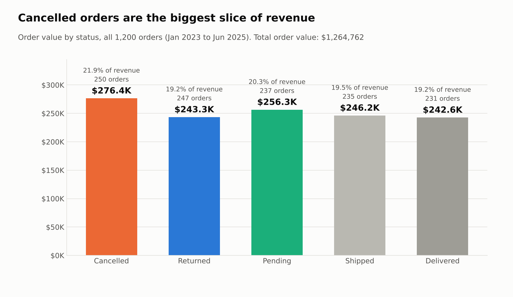
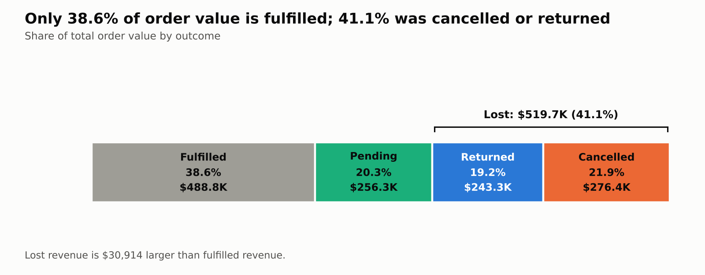
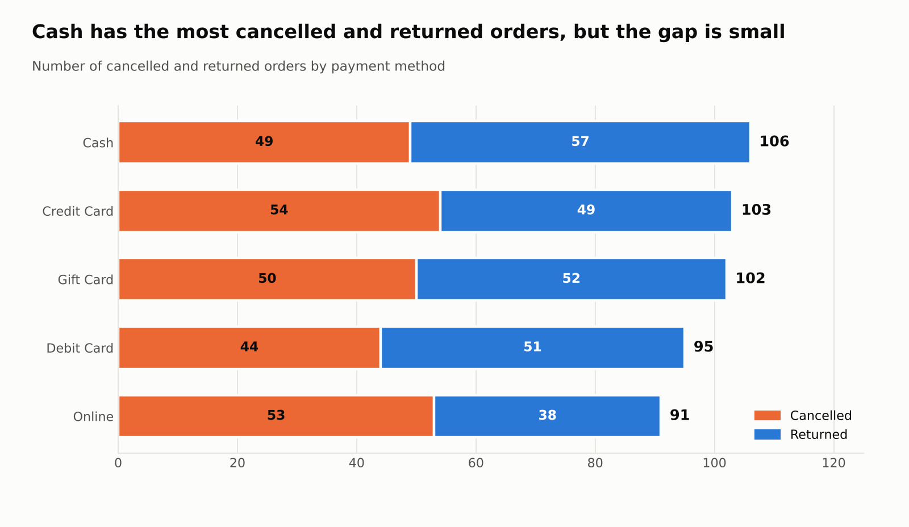
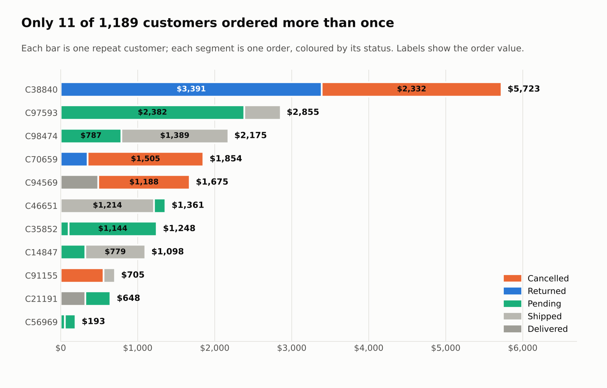

# Business_performance_SQL_continuation-2
This a SQL aspect of  pervious business_performance_analysis
# Sales Order Analysis (SQL)

An SQL analysis of 1,200 e-commerce orders (January 2023 to June 2025), looking at how much order value is actually kept, which payment methods are linked to cancellations and returns, and who the repeat customers are.


## Business questions

1. What is the real revenue by order status, with a focus on Cancelled, Returned and Pending orders?
2. Which payment method is linked to the most cancellations and returns?
3. Which customers placed more than one order, and how much did they spend?

## Tools

SQL (PostgreSQL), written and run in Visual Studio Code.

## Dataset
*Database creation code:
```SQL
CREATE DATABASE "Decodelabs dataset"
```
Table creation code:
```SQL
CREATE TABLE public.Salesreport
(Order_id TEXT,Date DATE,customer_id TEXT,Product VARCHAR(30),Quantity INT,Unitprice NUMERIC,Shipping_address TEXT,
Payment_method VARCHAR(30),Order_status VARCHAR(30),Tracking_number TEXT,Itemsincart INT,
Coupon_code VARCHAR(20),Referral_source VARCHAR(30),Total_price NUMERIC )
```


 1,200 orders and 1,189 unique customers, loaded into a table called `salesreport`.

| Column | Description |
|---|---|
| order_id, customer_id, date | Order identifiers and order date |
| product, quantity, unitprice | What was bought and at what price |
| total_price | Order value (quantity × unit price) |
| payment_method | Cash, Credit Card, Debit Card, Gift Card, Online |
| order_status | Delivered, Shipped, Pending, Cancelled, Returned |


## 1. Real revenue by order status

*SQL: 
```SQL
SELECT
payment_method,order_status,
COUNT(quantity)
FROM
salesreport
WHERE 
order_status IN ('Cancelled','Returned')
GROUP BY
payment_method,order_status,quantity
```



| Status | Orders | Revenue | Share | Avg order value |
|---|---:|---:|---:|---:|
| Cancelled | 250 | $276,396.21 | 21.9% | $1,105.58 |
| Pending | 237 | $256,328.15 | 20.3% | $1,081.55 |
| Shipped | 235 | $246,159.58 | 19.5% | $1,047.49 |
| Returned | 247 | $243,277.70 | 19.2% | $984.93 |
| Delivered | 231 | $242,600.32 | 19.2% | $1,050.22 |



**Insights**

- Total order value is **$1,264,761.96**, but only **$488,759.90 (38.6%)** was fulfilled.
- **$519,673.91 (41.1%)** was lost to cancellations and returns, which is $30.9K more than was fulfilled.
- **Cancelled is the largest single status** ($276.4K) and has the highest average order value ($1,106 against $1,054 overall), so bigger orders are slightly more likely to be cancelled.
- **$256.3K (20.3%) is still pending**, so it cannot yet be counted as real revenue.

---

## 2. Payment method and cancellations / returns



| Payment method | Cancelled | Returned | Total | Orders | Rate |
|---|---:|---:|---:|---:|---:|
| Cash | 49 | 57 | **106** | 246 | 43.1% |
| Credit Card | 54 | 49 | 103 | 234 | 44.0% |
| Gift Card | 50 | 52 | 102 | 230 | **44.3%** |
| Debit Card | 44 | 51 | 95 | 232 | 40.9% |
| Online | 53 | 38 | 91 | 258 | **35.3%** |

**Insights**

- **Cash is linked to the most cancelled and returned orders (106)**, including the most returns (57).
- **Gift Card has the highest rate (44.3%)**, with Credit Card close behind (44.0%). Credit Card has the most cancellations (54).
- **Online has the fewest problem orders (91) and the lowest rate (35.3%)** despite having the most orders, mainly because of fewer returns (38).
- The methods are close together, so the gaps are small. Online is the only one that clearly stands out.

---

## 3. Repeat customers

*SQL: 
```SQL
SELECT DISTINCT
customer_id,order_id,quantity,
TO_CHAR(SUM(unitprice),'FM$999,999,999.99') AS Total_amount_spent 
FROM
salesreport
WHERE
order_id IS NOT NULL AND customer_id
IS NOT NULL AND quantity >'2'
GROUP BY
customer_id,order_id,quantity,unitprice;
```



| Customer | Orders | Total spent |
|---|---:|---:|
| C38840 | 2 | $5,723.23 |
| C97593 | 2 | $2,855.22 |
| C98474 | 2 | $2,175.34 |
| C70659 | 2 | $1,853.96 |
| C94569 | 2 | $1,675.35 |
| C46651 | 2 | $1,360.89 |
| C35852 | 2 | $1,248.39 |
| C14847 | 2 | $1,097.81 |
| C91155 | 2 | $704.82 |
| C21191 | 2 | $647.77 |
| C56969 | 2 | $193.00 |

**Insights**

- **Only 11 of 1,189 customers (0.93%) ordered more than once**, each placing exactly two orders.
- Together they spent **$19,535.78**, only 1.5% of total order value.
- The top spender, **C38840 ($5,723.23)**, had one order returned and the other cancelled.
- Their orders fared no better than average: of their 22 orders, 9 are pending, 6 were cancelled or returned and only 7 were delivered or shipped.

---

## Conclusion

Of the $1.26 million in order value, only about 39% was delivered or shipped. More than 41% was cancelled or returned, and another 20% is still pending, so the headline total overstates what the business actually earned. Cancelled orders are the biggest single loss and are also slightly larger than average. By payment method, Cash is linked to the most cancelled and returned orders, Gift Card and Credit Card have the highest rates, and Online performs best, although the gaps between methods are small. Customer retention is very low: fewer than 1% of customers ordered a second time, and those who did were just as likely to have an order cancelled, returned or left pending. The most useful next step would be to look into why orders are cancelled or returned, starting with the large pending backlog, since this dataset shows where revenue is lost but not the reasons.

## How to reproduce

```sql
-- In PostgreSQL (psql, run from the repo root)
\i sql/00_create_table.sql
\copy public.salesreport FROM 'data/sales_orders.csv' WITH (FORMAT csv, HEADER true)
```

Then run `sql/01` to `sql/03` in Visual Studio Code.

